 

  

---

<h2 align="center">01 · About me</h2>

<table>
<tr>
<td width="60%" valign="top">

### Hello, I'm Emy.

I'm a Computer Science Engineering student specializing in **Big Data and Artificial Intelligence**. I like understanding how things work, designing backend systems, exploring data, and turning ideas into working applications.

- **Currently exploring:** Machine Learning and Data Engineering
- **Interested in:** Backend architecture, AI and Big Data
- **Building:** Full-stack applications and data projects
- **Belief:** Understand the fundamentals before writing the code.

</td>
<td width="40%" align="center" valign="middle">

*curiosity is my favorite tool.*

</td>
</tr>
</table>

---

<h2 align="center">02 · Tech stack</h2>

**Backend**

**Data and AI**

**Databases**

**Frontend**

**DevOps and tools**

---

<h2 align="center">03 · Selected projects</h2>

### AI Fitness Platform

*A smart fitness management platform combining software engineering and AI.*

- Role-based access control with JWT authentication
- Fitness and club management
- Coach and client management
- Progress tracking
- AI-assisted fitness features

 

| Project | Stack | What it does |
|---|---|---|
| **Smart Sport App** | Spring Boot, Angular, Docker, Kubernetes, Azure | Team project with an AI model, deployed to the cloud |
| **Smart Inventory and Order Management** | Angular, ASP.NET Core Web API | Inventory and order workflow system |
| **GesPlanta** | .NET 8, ASP.NET Core MVC | HR and plant management system |

---

<h2 align="center">04 · GitHub activity</h2>

  

  

---

<h2 align="center">05 · Currently growing</h2>

`Advanced Java and Spring Boot` · `Data Engineering and ETL` · `SQL and Database Architecture` · `Machine Learning` · `Docker, Kubernetes and Cloud`

---

<h3>Beyond the terminal</h3>

Anime enthusiast · Astronomy lover · Curious mind

*Currently inspired by Maomao and Anya.*

 

